# 🏰 Project Q1Q3

> **Quakeworld conversion project** — mostly Quake 3 maps converted to Quake 1 / QuakeWorld.
>
> All QW conversions by **Mick**

---

## 📊 Status Overview

| Status         | Count |
|----------------|-------|
| ✅ Finished     | 9     |
| 🔧 In Progress | 10    |
| 📋 Planned     | 3     |

---

## 🗺️ Maps

<!-- Add screenshots to the img/ folder named after each map, e.g. img/q1q3almostlost.png -->

### ✅ Finished

<table>
  <tr>
    <td width="220">
      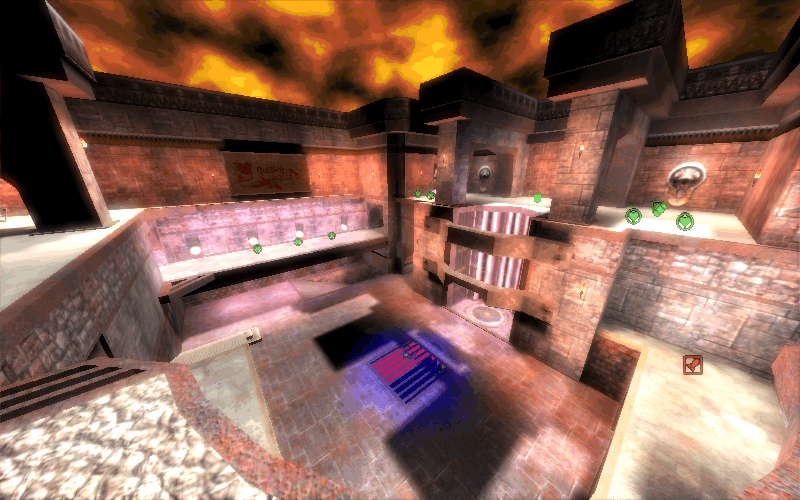
    </td>
    <td>
      <h4>🗺️ q1q3almostlost — <i>Almost Lost</i></h4>
      

        <b>Original Author:</b> id Software 
        <b>Q3 Map:</b> q3dm11 
        <b>Status:</b> ✅ Finished (24bit)
      

    </td>
  </tr>
</table>

<table>
  <tr>
    <td width="220">
      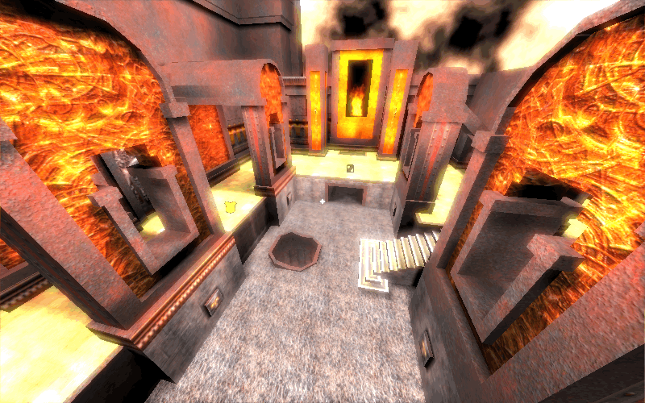
    </td>
    <td>
      <h4>🗺️ q1q3dm14 — <i>Grim Dungeons</i></h4>
      

        <b>Original Author:</b> id Software 
        <b>Q3 Map:</b> q3dm14 
        <b>Status:</b> ✅ Finished (24bit & FBCA Waypoint)
      

    </td>
  </tr>
</table>

<table>
  <tr>
    <td width="220">
      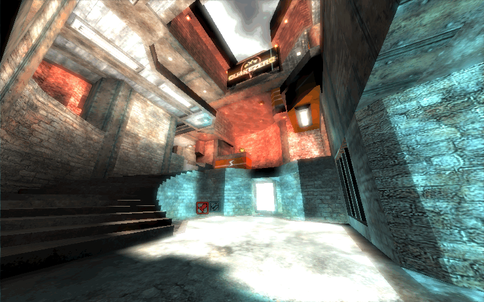
    </td>
    <td>
      <h4>🗺️ q1q3hektik — <i>Hektik</i></h4>
      

        <b>Original Author:</b> swelt 
        <b>Status:</b> ✅ Finished (24bit & FBCA Waypoint)
      

    </td>
  </tr>
</table>

<table>
  <tr>
    <td width="220">
      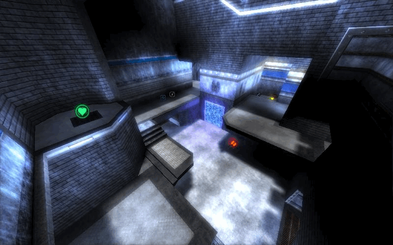
    </td>
    <td>
      <h4>🗺️ q1q3monsoon — <i>Monsoon</i></h4>
      

        <b>Original Author:</b> Lukin (xtn's remix) 
        <b>Status:</b> ✅ Finished (24bit & FBCA Waypoint)
      

    </td>
  </tr>
</table>

<table>
  <tr>
    <td width="220">
      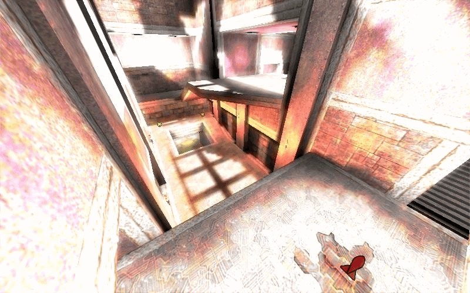
    </td>
    <td>
      <h4>🗺️ q1q3ospdm5 — <i>Deep Inside</i></h4>
      

        <b>Original Author:</b> Teddy 
        <b>Status:</b> ✅ Finished (24bit & FBCA Waypoint)
      

    </td>
  </tr>
</table>

<table>
  <tr>
    <td width="220">
      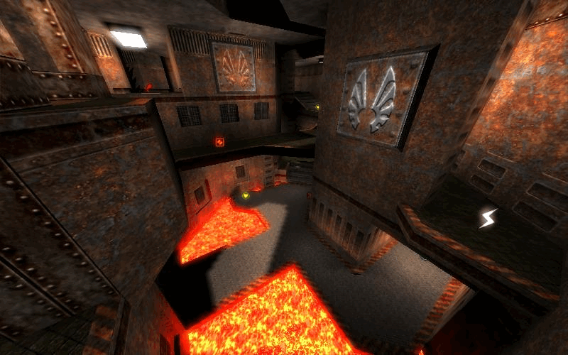
    </td>
    <td>
      <h4>🗺️ q1q3phrantic — <i>Phrantic</i></h4>
      

        <b>Original Author:</b> swelt 
        <b>Status:</b> ✅ Finished (24bit & FBCA Waypoint)
      

    </td>
  </tr>
</table>

<table>
  <tr>
    <td width="220">
      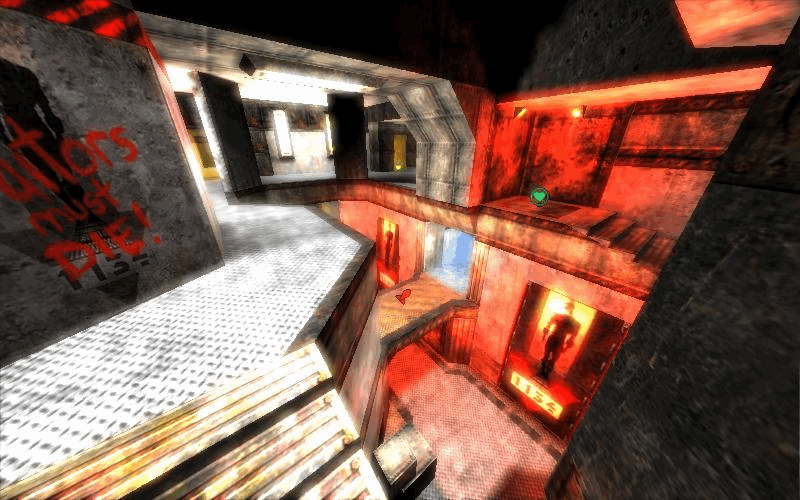
    </td>
    <td>
      <h4>🗺️ q1q3solid — <i>Solid</i></h4>
      

        <b>Original Author:</b> swelt 
        <b>Status:</b> ✅ Finished (24bit & FBCA Waypoint)
      

    </td>
  </tr>
</table>

<table>
  <tr>
    <td width="220">
      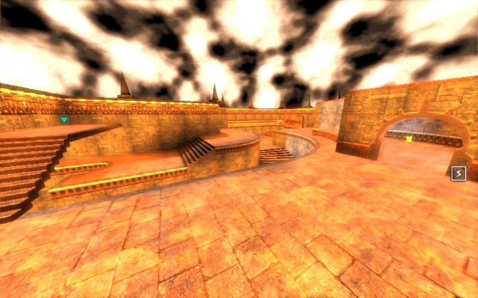
    </td>
    <td>
      <h4>🗺️ q1q3thunderstruck — <i>Thunderstruck</i></h4>
      

        <b>Original Author:</b> — 
        <b>Status:</b> ✅ Finished (24bit & FBCA Waypoint)
      

    </td>
  </tr>
</table>

<table>
  <tr>
    <td width="220">
      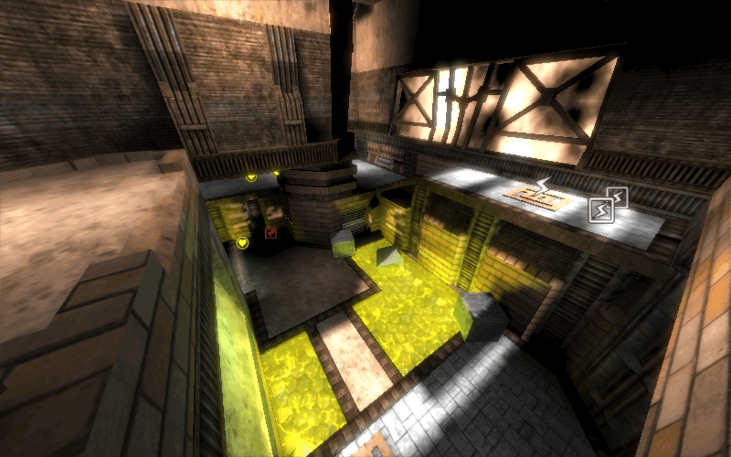
    </td>
    <td>
      <h4>🗺️ q1q3toxicity — <i>Toxicity</i></h4>
      

        <b>Original Author:</b> thefury 
        <b>Conversion:</b> Mick & Thuriam 
        <b>Status:</b> ✅ Finished (24bit)
      

    </td>
  </tr>
</table>

---

### 🔧 In Progress

<table>
  <tr>
    <td width="220">
      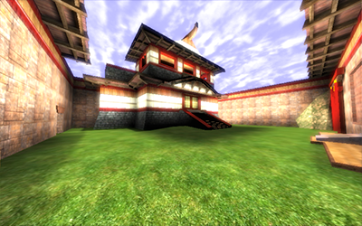
    </td>
    <td>
      <h4>🗺️ japanc — <i>Japanese Castles</i></h4>
      

        <b>Original Author:</b> g1zm0 
        <b>Game Mode:</b> QWTF (CTF) 
        <b>Status:</b> 🔧 Need beta testing (24bit)
      

    </td>
  </tr>
</table>

<table>
  <tr>
    <td width="220">
      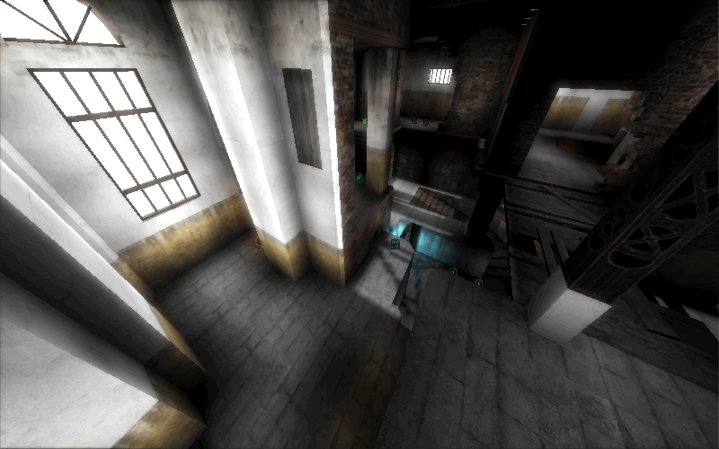
    </td>
    <td>
      <h4>🗺️ q1q3asylum — <i>Asylum</i></h4>
      

        <b>Original Author:</b> id Software 
        <b>Status:</b> 🔧 Need play testing (24bit)
      

    </td>
  </tr>
</table>

<table>
  <tr>
    <td width="220">
      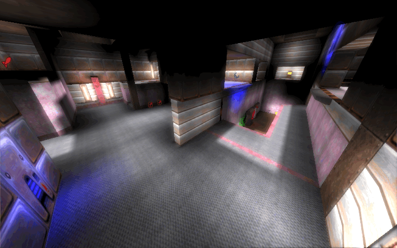
    </td>
    <td>
      <h4>🗺️ q1q3cpm4 — <i>Realm of Steel Rats</i></h4>
      

        <b>Original Author:</b> Khaile 
        <b>Status:</b> 🔧 Need beta testing (24bit)
      

    </td>
  </tr>
</table>

<table>
  <tr>
    <td width="220">
      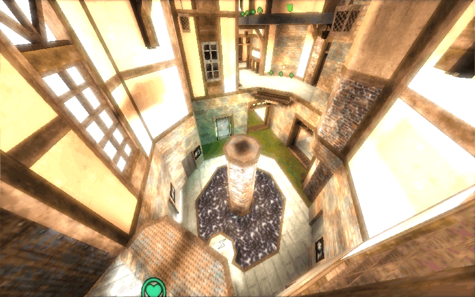
    </td>
    <td>
      <h4>🗺️ q1q3cure — <i>Cure</i></h4>
      

        <b>Original Author:</b> Ferdinand 'cityy' List 
        <b>Status:</b> 🔧 Need ideas/test/bugfix (24bit)
      

    </td>
  </tr>
</table>

<table>
  <tr>
    <td width="220">
      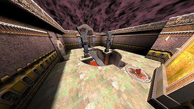
    </td>
    <td>
      <h4>🗺️ q1q3dm7 — <i>Temple of Retribution</i></h4>
      

        <b>Original Author:</b> id Software 
        <b>Status:</b> 🔧 Need some bug fixing
      

    </td>
  </tr>
</table>

<table>
  <tr>
    <td width="220">
      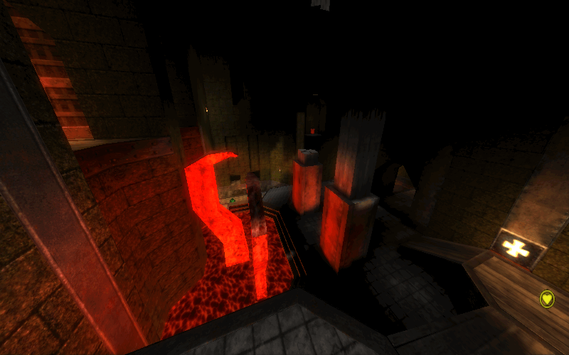
    </td>
    <td>
      <h4>🗺️ q1q3elder — <i>Elder</i></h4>
      

        <b>Original Author:</b> id Software 
        <b>Status:</b> 🔧 Need testing (24bit)
      

    </td>
  </tr>
</table>

<table>
  <tr>
    <td width="220">
      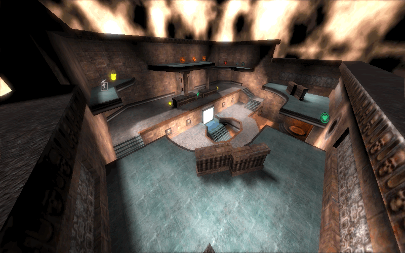
    </td>
    <td>
      <h4>🗺️ q1q3evolution — <i>Evolution</i></h4>
      

        <b>Original Author:</b> Till Merker 
        <b>Status:</b> 🔧 Need play testing (24bit & FBCA Waypoint)
      

    </td>
  </tr>
</table>

<table>
  <tr>
    <td width="220">
      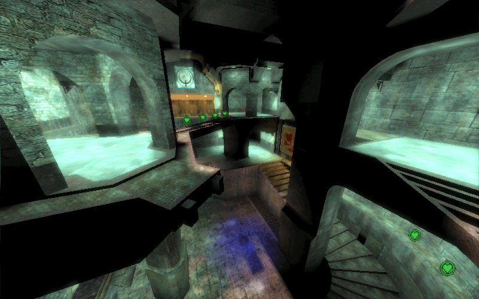
    </td>
    <td>
      <h4>🗺️ q1q3fheights — <i>Furious Heights</i></h4>
      

        <b>Original Author:</b> id Software 
        <b>Status:</b> 🔧 Need work (24bit)
      

    </td>
  </tr>
</table>

<table>
  <tr>
    <td width="220">
      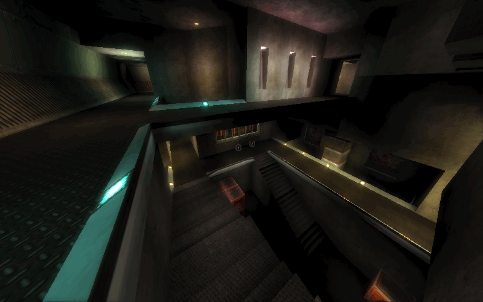
    </td>
    <td>
      <h4>🗺️ q1q3gaudy — <i>Gaudy</i></h4>
      

        <b>Original Author:</b> HAL9000 
        <b>Status:</b> 🔧 Need testing and weapon re-placement (24bit)
      

    </td>
  </tr>
</table>

<table>
  <tr>
    <td width="220">
      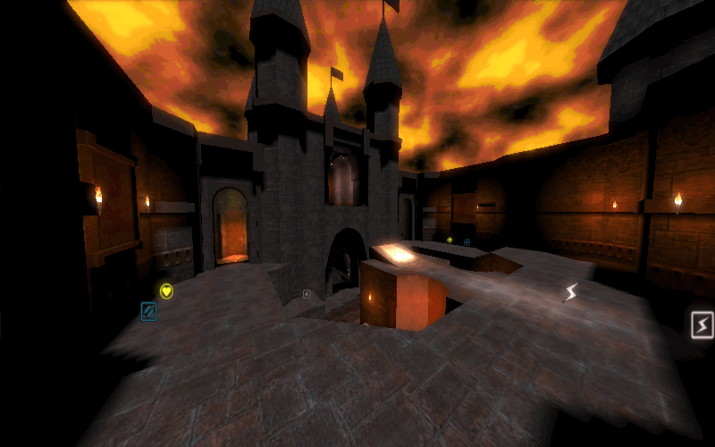
    </td>
    <td>
      <h4>🗺️ q1q3lastgift — <i>The Last Gift</i></h4>
      

        <b>Original Author:</b> Suicide-20 
        <b>Status:</b> 🔧 Need playtest and possibly replace items
      

    </td>
  </tr>
</table>

<table>
  <tr>
    <td width="220">
      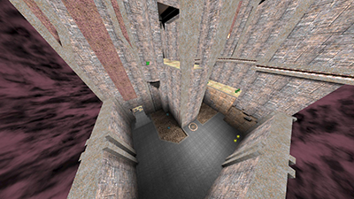
    </td>
    <td>
      <h4>🗺️ q1q3overkill — <i>All The Aces</i></h4>
      

        <b>Original Author:</b> Wiebo 
        <b>Status:</b> 🔧 Need retexturing and beta testing
      

    </td>
  </tr>
</table>

<table>
  <tr>
    <td width="220">
      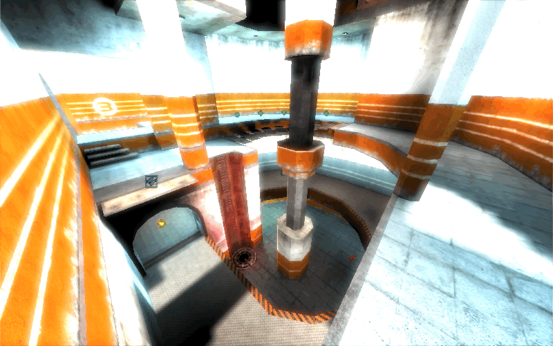
    </td>
    <td>
      <h4>🗺️ q1q3trinity — <i>Trinity</i></h4>
      

        <b>Original Author:</b> id Software 
        <b>Status:</b> 🔧 Need beta test and bug search (24bit)
      

    </td>
  </tr>
</table>

<table>
  <tr>
    <td width="220">
      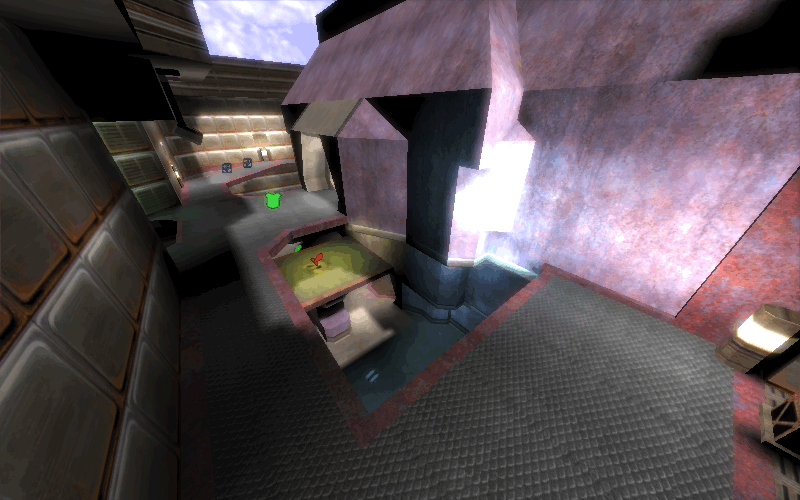
    </td>
    <td>
      <h4>🗺️ q1q3vertical — <i>Vertical Vengeance</i></h4>
      

        <b>Original Author:</b> id Software 
        <b>Status:</b> 🔧 Need beta testing (24bit & FBCA Waypoint)
      

    </td>
  </tr>
</table>

---

### 📋 Planned

<table>
  <tr>
    <td width="220">
      
    </td>
    <td>
      <h4>🗺️ q1ra3map5 — <i>Lost Faith</i></h4>
      

        <b>Original Author:</b> Suicide20 
        <b>Status:</b> 🔧 Working on light and weapon placements
      

    </td>
  </tr>
</table>

<table>
  <tr>
    <td width="220">
      
    </td>
    <td>
      <h4>🗺️ q1q3drunkmummy — <i>Drunken Monkey</i></h4>
      

        <b>Original Author:</b> — 
        <b>Status:</b> 📋 Planned
      

    </td>
  </tr>
</table>

<table>
  <tr>
    <td width="220">
      
    </td>
    <td>
      <h4>🗺️ q1q3houseofdecay — <i>House of Decay</i></h4>
      

        <b>Original Author:</b> id Software 
        <b>Status:</b> 📋 Planned
      

    </td>
  </tr>
</table>

<table>
  <tr>
    <td width="220">
      
    </td>
    <td>
      <h4>🗺️ q1q3shaken — <i>Shaken Not Stirred</i></h4>
      

        <b>Original Author:</b> Senn 
        <b>Status:</b> 📋 Planned
      

    </td>
  </tr>
</table>

<table>
  <tr>
    <td width="220">
      
    </td>
    <td>
      <h4>🗺️ q1q3sinister — <i>Sinister</i></h4>
      

        <b>Original Author:</b> — 
        <b>Status:</b> 📋 Planned
      

    </td>
  </tr>
</table>

---

## 🛠️ Q1Q3 Utility

A GUI application for map conversion workflow:

- **Find & rename** texture strings in `.map` files (outputs `*_fixed.map`)
- **Decompile** Q3 maps using q3map2
- **Generate** map-specific `.wad` and 24bit texture folders

Uses a semicolon-separated config file with 2 columns (no empty lines).

### Requirements

- [Python 3](https://www.python.org/downloads/)
- [q3map2](http://q3map2.robotrenegade.com/)

---

## 📥 Downloads

- **Full package (forum):** https://www.quakeworld.nu/forum/topic/6152
- **Map package (releases):** https://github.com/mickkn/projectq1q3/releases